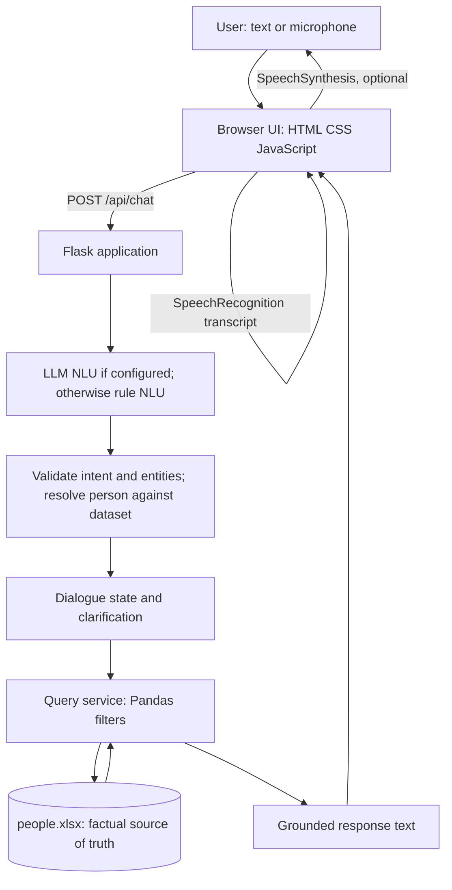

# Final system architecture (V5)

**Version evolution:** V1 Browser → Flask → deterministic rules → Pandas → Excel; V2 adds explicit intent/entity parsing and query-service separation; V3 adds dialogue state and clarification; V4 uses an LLM only as an NLU parser followed by validation and grounded spreadsheet lookup; V5 adds speech recognition and synthesis around the same backend.
