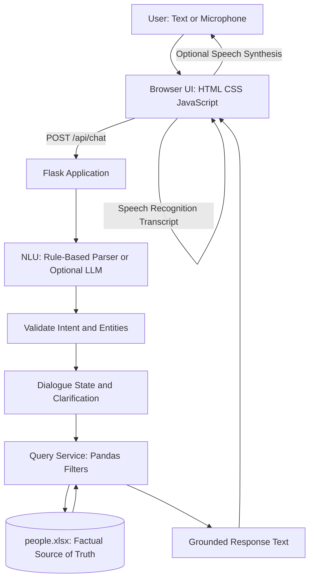

# Final System Architecture — CIUX Birthday Assistant V1 to V5

## 1. System Architecture Diagram

The following diagram shows the architecture of the final V5 Birthday Assistant.

## 2. Architecture Components

1. **User Interface:** Allows users to enter questions through text or microphone.
2. **Browser Interface:** Uses HTML, CSS and JavaScript to display conversations and handle voice interaction.
3. **Flask Application:** Receives user requests and connects the frontend with the backend.
4. **NLU Component:** Identifies user intent and extracts entities using rule-based parsing or optional LLM assistance.
5. **Validation Component:** Checks extracted information and resolves people against the dataset.
6. **Dialogue Management:** Maintains conversation context and handles clarification.
7. **Query Service:** Uses Pandas to filter and retrieve birthday information.
8. **Excel Workbook:** Stores synthetic birthday information and acts as the factual source of truth.
9. **Response Generation:** Creates responses using retrieved information.
10. **Speech Synthesis:** Optionally reads responses aloud in V5.

## 3. Version Evolution

- **V1 — Deterministic Rules:** Browser → Flask → Rule Parser → Pandas → Excel.
- **V2 — Intent and Entities:** Adds separate intent/entity parsing and query-service components.
- **V3 — Dialogue Management:** Adds conversation state, follow-up handling and clarification.
- **V4 — LLM-Assisted NLU:** Adds optional LLM parsing, validation, spreadsheet grounding and rule-based fallback.
- **V5 — Voice Interface:** Adds browser-based speech recognition and speech synthesis around the existing backend.

## 4. Data Flow

1. The user enters a question or speaks through the microphone.
2. The browser sends the question to the Flask backend.
3. The NLU component identifies the intent and entities.
4. The application validates the extracted information.
5. Dialogue management handles context and clarification when required.
6. The query service retrieves information from the Excel workbook using Pandas.
7. The application generates a response using the retrieved data.
8. The browser displays the response and can optionally read it aloud in V5.

## 5. Conclusion

The Birthday Assistant architecture develops progressively from a simple rule-based system into a conversational application with intent recognition, dialogue management, optional LLM assistance and voice interaction. The Excel workbook remains the source of factual birthday information throughout the system.